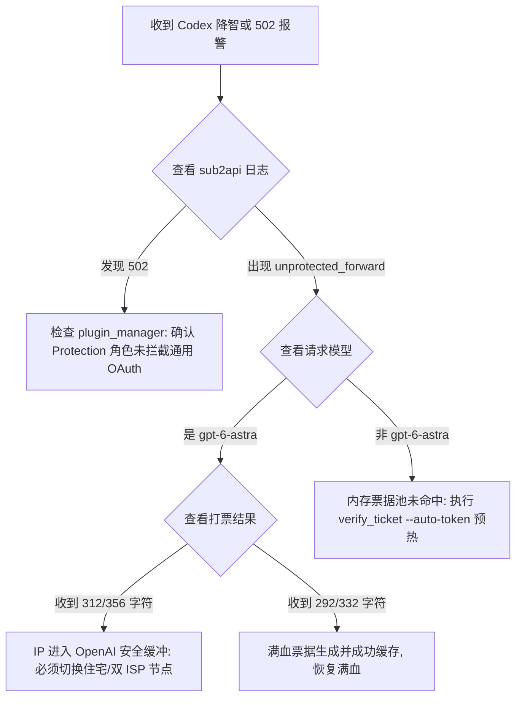

# OpenAI Codex 降智诊断与票据采集排障技能 (State Harvest & Anti-Downgrade)

本技能沉淀了在 Sub2API 体系下，针对 OpenAI Codex / ChatGPT Backend-API 降智机制、`X-Codex-Turn-State` 状态票据原理、打票网络隔离（防 Agent 自身断网）、502 穿透 Bug 根治、住宅 IP 纯净度判定，以及票据池常态化预热维护的全部一线生产实战经验。

---

## 1. 核心理论：票据机制与降智判定

OpenAI 官方在面向 Codex（如 VSCode/Cursor 等客户端接口）的请求网关中，通过响应头 `X-Codex-Turn-State` 传递会话安全与上下文状态票据。

### 1.1 票据解包与数据块计算公式
`X-Codex-Turn-State` 采用 **URL-safe Base64 (RFC 4648 without padding)** 编码。
解码后的二进制长度存在严格的数据块（Chunk）规律：
- **基础头部开销**：57 字节（包含状态元数据、版本标识及哈希签名等）。
- **每个数据块大小**：16 字节（128-bit state block）。
- **数据块数计算公式**：
  $$\text{Chunks} = \frac{\text{len}(\text{decoded\_bytes}) - 57}{16}$$

### 1.2 票据长度与状态判定矩阵

| Base64 长度 | 解码字节 | 数据块数 (Chunks) | 伴随特征响应头 | 状态判定 | 插件与系统处理策略 |
| :--- | :--- | :--- | :--- | :--- | :--- |
| **292 字符** | 217 字节 | **10 块** | 无 safety-buffering | **个人满血态 (Personal Normal)** | **合格，采纳并缓存**，注入后续请求 |
| **332 字符** | 249 字节 | **12 块** | 无 safety-buffering | **企业满血态 (Team/Business)** | **合格，采纳并缓存**，注入后续请求 |
| **312 字符** | 233 字节 | **11 块** | `x-codex-safety-buffering-enabled: true` | **降智受限态 (Personal Degraded)** | **劣质票，坚决拒收**，丢弃不缓存，降级透传 |
| **356 字符** | 265 字节 | **13 块** | `x-codex-safety-buffering-enabled: true` | **降智受限态 (Team Degraded)** | **劣质票，坚决拒收**，丢弃不缓存，降级透传 |

> [!IMPORTANT]
> **降智的本质机理**：
> 当 OpenAI 网关识别到出口 IP 属于公开数据中心机房（DataCenter/Hosting）、请求 TLS 指纹异常、或同一出口存在异常高并发时，风控引擎会在响应中强制激活 **Safety Buffering**：
> 1. 响应头附加：`x-codex-safety-buffering-enabled: true`；
> 2. 在 State 结构中强行插入 1 块缓冲控制块（10 块变 11 块，12 块变 13 块）；
> 3. 被插入缓冲块的请求，其上下文思考深度会被阉割，输出内容变得极其敷衍或回复迟缓。
> **铁律**：`sub2api-state-reuse` 插件只接收 292 与 332 字符的票据，**绝不入库 312/356 票据**！

---

## 2. 采票网络与代理架构禁忌（防自身断网与认知偏差）

### 2.1 铁律：绝对不可改动 Agent 依赖的默认代理与选择器
- **惨痛教训回顾**：
  在排查采票链路时，曾在控制面板中临时切换 Mihomo 的 `proxy` 或 `美国IP` Selector，导致本地正在工作的 AI Agent (Antigravity / agy / Gemini CLI) 瞬间失联断线。
- **断网根本原因**：
  AI Agent 与 Google DeepMind API 的长连接通信完全依赖系统环境代理 `http://127.0.0.1:7890`。一旦 7890 的全局或默认分流出口被切到不可用节点，Agent 无法向 Google 发送和接收 token，会话直接死亡。
- **架构隔离方案（双出口与专属 Listener）**：
  打票网络必须与 Agent 工作网络做彻底的物理/逻辑隔离，推荐以下两种方式：
  1. **方案 A：Mihomo 独立 Listener（专线端口 18300）**
     在 `/etc/mihomo/config.yaml` 中新增独立的混合监听端口，指定独立的打票节点/策略组，完全不干扰 7890：
     ```yaml
     listeners:
       - name: harvest-in
         type: mixed
         port: 18300
         listen: 127.0.0.1
         proxy: "美西-原生双ISP住宅"
     ```
     配置更新后执行热重载（无需重启进程）：
     ```bash
     curl -s -X PUT http://127.0.0.1:9090/configs?force=true -d '{"path": "/etc/mihomo/config.yaml"}'
     ```
  2. **方案 B：独立第三方代理出口（Direct Outbound）**
     直接将打票脚本或 Sub2API 的代理配置指向专用代理主机（例如 `http://us.fpsq.xyz:17891`），完全绕开本机代理程序。

### 2.2 认知偏差矫正：网页端 403 盾 vs API 接口直连
- **常见误区**：很多人直接使用 `curl -I https://chatgpt.com` 发现返回 `403 Forbidden`（Cloudflare 5秒人机盾 Challenge），就误以为“这个 IP 被 OpenAI 彻底拉黑封禁了，打不了票”。
- **真实逻辑**：
  - Cloudflare 网页盾主要针对浏览器页面的无头爬虫与非交互式 HTTP 请求；
  - 真正打票的 API 端点是：`https://chatgpt.com/backend-api/codex/responses`；
  - 该端点走的是 OAuth 鉴权体系。只要携带合规的 `Authorization: Bearer <token>`、合法合规的桌面浏览器 `User-Agent` 与合法 JSON 请求体，**API 请求并不会触发 Cloudflare 网页盾，可直接返回 200 成功响应！**
- **机房 IP vs 原生住宅 IP 的差异**：
  - 机房 IP 虽能调通 API（返回 200），但由于 IP 信誉低，**必定返回 312 降智票**；
  - 纯净原生住宅/双 ISP IP 调通 API 时，**稳定返回 292 满血票**。
  - 因此，“能否打到满血票”考验的是 IP 的住宅纯净度，而非“能不能过网页 403 盾”。

---

## 3. Sub2API 插件体系与 502 穿透 Bug 根治

在 Sub2API 架构中，`sub2api-state-reuse`（FlowNode STATE 292/332 Reuse）插件是以独立的外部 Go 进程运行（Plugin v2 机制，通过 hashicorp/go-plugin RPC 与主进程通信）。

### 3.1 502 穿透 Bug 根因剖析
- **故障现象**：在启用该插件后，线上部分账号（如非保护的普通 OpenAI OAuth 账号或其它渠道）突然大面积返回 `502 Bad Gateway`。
- **深层根因**：
  - Sub2API 的 `backend/internal/service/plugin_manager.go` 中，`ShouldRouteOpenAIOAuth` 和 `RoundTripOpenAIOAuth` 仅简单判断了 `plugin.IsEnabled()`，没有核验插件角色（`PluginRole`）。
  - 当加载了 Protection 角色插件（`PluginRoleOpenAIProtection`）时，系统把保护插件错误地当作通用的“OAuth 传输拦截器”执行 RoundTrip。
  - 由于保护插件没有实现通用的 OAuth 上游转发，导致请求在网关层悬空失败，产生 502 穿透。
- **关键代码修复**：
  1. `plugin_manager.go`：在通用 OAuth 传输循环中，强制跳过保护角色插件：
     ```go
     if runtime.Role == PluginRoleOpenAIProtection {
         continue // 保护插件专属于保护链路，严禁拦截通用 OAuth 传输
     }
     ```
  2. `openai_plugin_transport.go`：限定仅在当前账号配置明确声明启用 Protection 时才接入保护运行时；若账号未开启保护或保护插件不可用，无缝退回原生 HTTP 传输（`unprotected_forward`），杜绝 502。
  3. 测试保障：增加单测 `TestRoundTripOpenAIOAuthSkipsProtectionRuntime` 持续守护。

### 3.2 插件在线采票触发模型限制
- **源码硬编码逻辑**：
  `sub2api-state-reuse` 插件内部的 `p.ticket(...)` 在线自采打票逻辑**被硬编码为仅在请求模型为 `gpt-6-astra` 时触发**！
- **对于常见日常模型（如 `gpt-5.6-luna`, `gpt-5.6-sol`, `gpt-5.6-terra` 等）**：
  - 插件仅从**内存票据池**中尝试寻找对应账号的有效 292/332 票据；
  - 若内存缓存为空（例如服务刚重启或未预热），插件会打印日志：
    `unprotected_forward: no valid state ticket in cache`
    并将请求原样透传给 OpenAI，**绝不会在此刻发起在线打票**！

---

## 4. 票据池预热与全天候保鲜策略 (Warmup Runbook)

为了保证所有日常模型请求都能命中满血 292 票据，必须建立常态化票据池预热与保鲜机制。

### 4.1 预热机制原理
1. 插件在内存中维护了一个以 Account ID / Hash 为 Key 的 State Ticket 缓存。
2. 只要通过住宅专线向 `gpt-6-astra` 发送一次极小的合法探针请求，插件便会截获上游的 292 票据并写入内存。
3. 随后数小时内，用户发往该账号的所有日常模型请求（如 `gpt-5.6-luna`），均可自动注入该 292 票据，实现全链路满血。

### 4.2 自动化预热脚本
可在系统 Crontab 或定时任务中，每 20 分钟执行一次轻量预热探针（使用技能附带的工具）：
```bash
python3 /home/codes/third_party/sub2api/.agent/skills/state-harvest-antidowngrade/scripts/verify_ticket.py \
  --auto-token \
  --proxy "http://127.0.0.1:18300"
```

---

## 5. 诊断工具脚本使用指南

技能目录下提供了开箱即用的检测与采集工具：
[`scripts/verify_ticket.py`](file:///home/codes/third_party/sub2api/.agent/skills/state-harvest-antidowngrade/scripts/verify_ticket.py)

### 5.1 常用命令速查

```bash
# 1. 本地直接解包解析票据状态（无需网络）
python3 scripts/verify_ticket.py --ticket "u4y9_1N2Y7g0QfV6XwH8-kM1oP3rT5vX9zB2dF4hJ6l..."

# 2. 自动从 Sub2API 数据库拉取有效 OAuth 凭证，通过 18300 独立端口在线探针
python3 scripts/verify_ticket.py --auto-token --proxy "http://127.0.0.1:18300"

# 3. 指定 OAuth Token 与指定外部代理探测
python3 scripts/verify_ticket.py \
  --token "eyJhbGci..." \
  --proxy "http://us.fpsq.xyz:17891"
```

---

## 6. 生产故障全流程排查 (Runbook)



### 排查实操命令：
1. **检查插件子进程运行状态**：
   ```bash
   systemctl status sub2api.service --no-pager | grep state-reuse
   ```
2. **检索关键日志事件**：
   ```bash
   journalctl -u sub2api.service -n 100 --no-pager | grep -E "state-reuse|unprotected_forward|ticket rejected|502 Bad Gateway"
   ```
3. **验证打票专用代理端口状态（严禁碰 7890）**：
   ```bash
   curl -sI -x http://127.0.0.1:18300 https://www.google.com | head -n 1
   ```
4. **单次快速打票验真**：
   ```bash
   python3 .agent/skills/state-harvest-antidowngrade/scripts/verify_ticket.py --auto-token --proxy "http://127.0.0.1:18300"
   ```
